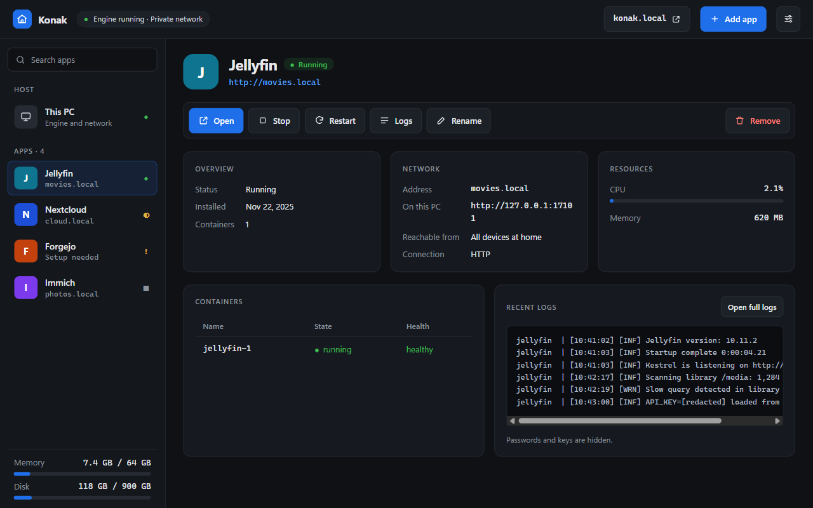
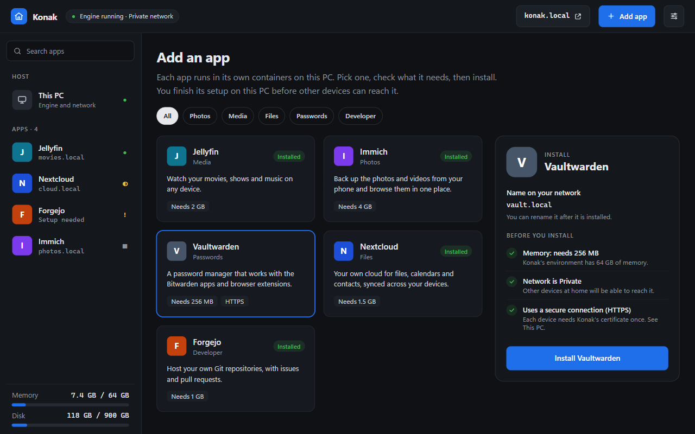
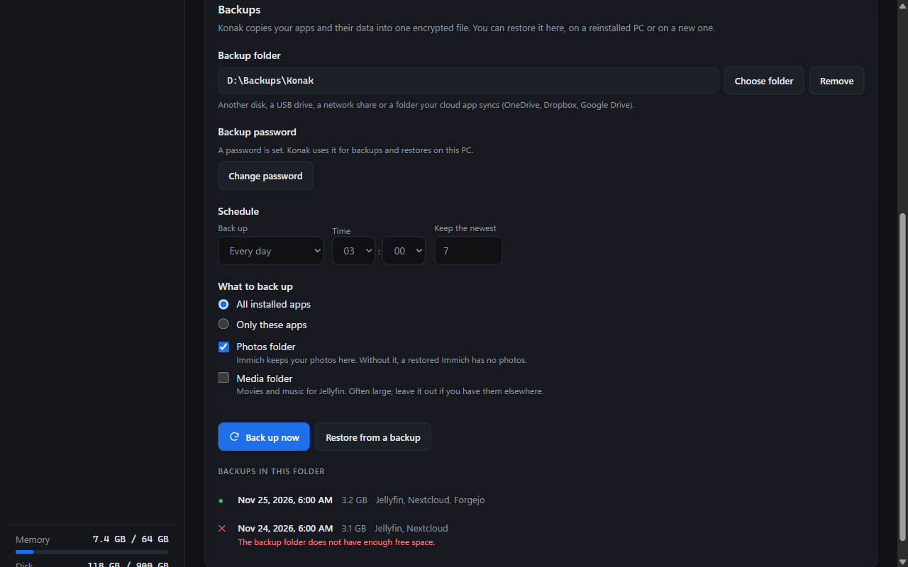

# Konak

**Turn your Windows PC into a home server, without touching a terminal.**

Konak (Turkish for *mansion*) installs and runs self-hosted apps such as Jellyfin, Immich, Nextcloud,
Vaultwarden and Forgejo on your own PC. Every device at home can reach them by name, like
`http://movies.local`. Konak sets up the Linux environment, the containers, the network names, the
firewall and the certificates, and it backs everything up.

> [!WARNING]
> **Konak is in active development.** It is not released yet. Features, file formats and the install
> layout can still change between versions, and there is no published installer. Do not keep data in it
> that you have no other copy of.



## What it does

- **One-click setup.** Konak asks for administrator permission once, then installs WSL 2 if it is
  missing, along with its own hidden Linux environment (Debian with Podman), the firewall rules and
  a local certificate authority. It does not need Docker Desktop, and it runs side by side with it
  and with your other WSL distributions.
- **An app catalog.** Jellyfin, Immich, Nextcloud, Vaultwarden and Forgejo, each from its upstream
  compose file with images pinned by digest. Konak checks memory and network before an install. You
  finish each app's own setup on this PC before other devices can reach it.
- **Names instead of ports.** Every app gets a `.local` name announced over mDNS (`movies.local`,
  `photos.local`, …), and you can rename it. `http://konak.local` is a home page that lists your apps.
- **HTTPS where it matters.** Apps that need a secure connection, such as Vaultwarden, get certificates
  from Konak's own certificate authority. That authority can only issue certificates for `.local` names.
  Each device installs its root certificate once, with guides for iPhone, Android, Windows and macOS.
- **Home network only.** Apps are reachable on private networks and blocked on public ones. During
  setup, Konak offers to switch a home network that Windows marks as Public to Private, and later it
  warns when the network is Public. It also never triggers Windows' "allow access" prompt. Before
  any administrator prompt, it shows exactly which firewall rules it will add.
- **Backup and restore.** Konak backs up your apps, their data and your Photos and Media folders into one
  encrypted file, on a schedule or on demand, and keeps the newest copies. You can restore everything,
  or only some apps, on the same PC or on a new one. A restore that fails part-way puts back what was
  there before.
- **Built-in diagnostics.** Konak checks its environment, the network, port 80, the firewall and WSL's
  networking mode (NAT or mirrored), and explains each problem in plain language with the fix.
- **An MCP server for AI agents.** AI assistants can check status, read logs and troubleshoot
  through Konak, instead of driving PowerShell or WSL directly. Every change an agent requests
  (install, remove, restart, …) waits for your click in the Konak window. The server is local only,
  and it hides secrets in everything it returns.
- **English and Turkish.** The interface follows your Windows display language.

| Add an app | Backups |
|---|---|
|  |  |

## Platforms

| Platform | Status |
|---|---|
| Windows 11 (x64) | In development |
| Linux | Planned |
| macOS | Planned |

The Windows version runs Linux containers in its own WSL 2 distribution. Linux and macOS versions are
planned and will use the same app catalog and interface.

## How it works

```
Konak (Tauri app + tray)
├── Caddy             reverse proxy on your LAN IP: <name>.local → the app
├── mDNS responder    announces konak.local and every app name
└── WSL 2 distro "konak"
    └── Podman + docker-compose
        └── one compose project per app, published on 127.0.0.1 only
```

Konak itself is a [Tauri](https://tauri.app) app: a Rust core with a Svelte and Tailwind CSS interface.
Caddy and the mDNS responder run as native Windows processes. Apps are plain compose projects,
reachable from other devices only through Caddy.

## Building from source

There is no installer to download yet. To build one on Windows 11 x64, you need Node.js and Rust:

```powershell
cd app
npm install
powershell -File scripts/prepare-bins.ps1   # fetches Caddy, builds the mDNS responder
npm run tauri build                          # per-user NSIS installer in src-tauri/target/release/bundle/nsis/
```

[`app/README.md`](app/README.md) covers development runs, where Konak keeps its files, the MCP server
and uninstalling.

## Roadmap

- Linux and macOS versions
- Remote access from outside the home through a guided Tailscale setup
- Your own domain (for example `home.arpa`) as an alternative to `.local` names
- More apps in the catalog

## Status of this repository

Konak is developed in the open, and the code changes quickly. Issues and ideas are welcome. Please
open an issue before starting on a larger change.

## License

Konak is free software, licensed under the [GNU General Public License](LICENSE), version 3 or
(at your option) any later version. The apps it installs, and the tools it bundles such as Caddy,
keep their own licenses.
